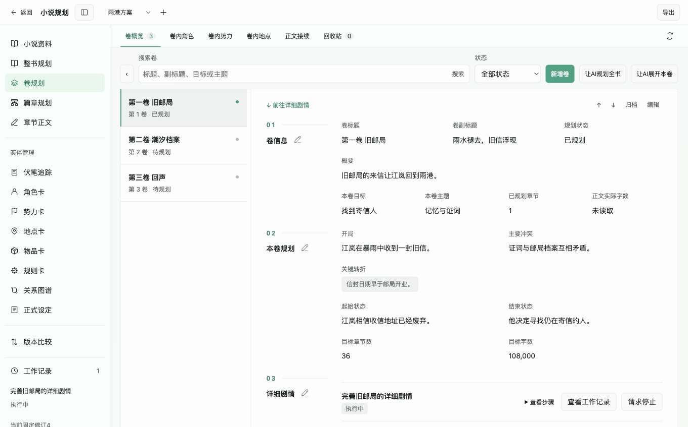

# 小说规划 Hetu Novel Planner

> 河图洛书的小说规划插件项目，围绕整书、卷和章组织创作结构，供外部Agent操作与作者审阅。

## 简介

`org.wordflowlab.novel-planner`以 TypeScript 后端和 React 工作面实现整书结构、节点详情、故事网络及工作记录。默认协作链路为**Codex → 河图CLI/MCP → 小说规划插件**；Skills提供方法，河图保存修订与操作结果，插件提供专业数据和可视化。

作者在对话中表达目标，回到河图阅读规划、比较变化、提出意见，也可以手动编辑。规划保存与正式大纲应用、正文采纳及定稿分别决定。

## 角色分流

| 任务 | 入口 |
| --- | --- |
| 理解用户需求与创作流程 | [产品需求](docs/01-产品需求PRD.md)、[用户用例](docs/05-用户故事与业务流程.md) |
| Review功能及Agent操作范围 | [功能清单](CAPABILITIES.md)、[API与Agent协作](docs/04-API与Agent协作合同.md) |
| 设计与开发 | [文档总入口](docs/README.md)、[技术架构](docs/02-总体架构与技术选型.md) |
| 核对实施与验证 | [实施计划](docs/08-实施计划与验收记录.md)、[测试矩阵](docs/07-测试策略与验收矩阵.md) |

## 快速上手

### 在河图中使用

使用具备开放宿主 SDK 的河图 0.10.0 或以上版本。从 [GitHub Release](https://github.com/wordflowlab/hetu-novel-planner/releases/tag/v0.1.0) 获取预构建包及摘要文件，向已接入河图的 Codex 说明：

> 检查并安装我选定的小说规划插件，核对固定来源和包摘要。读取当前小说及已有规划，按卷整理目标、主题、冲突、转折和详细剧情，保存后回读；保留正文、已定主张和原操作键。未知结果先查询原操作。

安装到河图后，在当前小说中打开“小说规划”。默认选中首个有效卷；左侧切换范围和实体，卷列表定位内容，详情按卷信息、卷规划、详细剧情阅读。规划目标交给外部 Agent，工作记录显示真实回传，作者可编辑和比较固定版本。



当前发行标记为开发预览；平台与质量证据由[实施记录](docs/08-实施计划与验收记录.md)维护。安装不需要 npm 或 Rust 编译，停用和卸载插件保留已保存的专业数据。

### 源码开发

开发环境使用 Node.js 25，依赖版本由 `package-lock.json` 固定：

```bash
npm ci
npm run check
npm run build
npm test
```

`npm test` 包含真实河图 CLI/MCP 测试，需要已构建的宿主。设置 `HETU_SOURCE` 指向宿主源码目录；默认使用仓库同层级的河图工程。桌面验证使用 `npm run test:ui`。前置构建、隔离数据和包校验见[开发说明](docs/09-开发发布与上架.md)。

构建产物位于 `dist/`，包含 `plugin.json`、预构建后端与工作面、规划方法、许可及第三方声明。通过河图安装并启用固定包后即可使用宿主核心，无需独立插件授权；Agent沿原作品连接发现实际能力，再携带包摘要、能力摘要和固定输入调用。专业动作见[功能清单](CAPABILITIES.md)，方法见[规划方法](methods/README.md)。

## 边界

- 河图管理插件，Codex经河图发现与调用；河图插件与Codex插件是独立概念。
- Cordis作为宿主内部基础，公共合同依赖河图SDK，作品格式不依赖框架对象。
- 规划对象、历史和固定引用由河图 Core 保存；工作记录描述外部执行情况，插件不执行 Agent 循环。
- 正文、正式卷章、正典与作者决定归宿主；插件不建立模型循环、账号或独立作品数据库。

## 协作方式

产品、数据、API、用例及验收按[文档归属](docs/README.md)维护。功能变化同步本仓库`CAPABILITIES.md`，可执行合同由实际包清单发布；不把专业功能逐条复制到宿主清单。许可为[Apache-2.0](LICENSE)。
