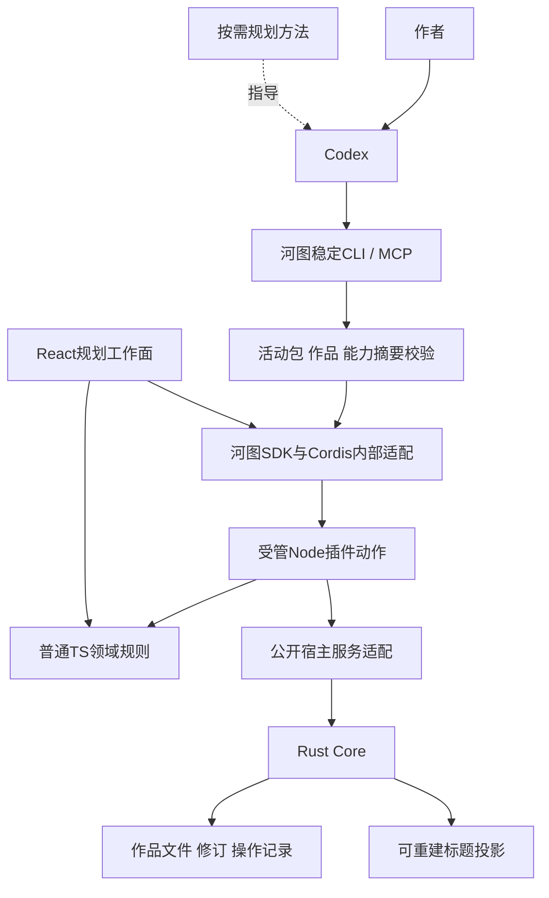
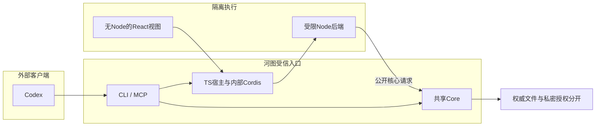

> 本文属于[小说规划文档](README.md)，拥有架构、进程、技术分工及框架边界。

# 总体架构与技术选型

## 1. 已采纳选型

| 层次 | 技术与责任 | 代价与边界 |
| --- | --- | --- |
| 外部智能 | Codex等Agent，按需Skills | 理解、创意、生成和返工；不嵌入插件运行时 |
| 公共入口 | 河图CLI/MCP与河图SDK | 本包不新增独立MCP Server或Codex插件 |
| 插件运行机制 | 宿主内部采用Cordis | 作用域与贡献释放；包依赖图及安装事实仍由宿主拥有 |
| 领域与动作 | TypeScript，编译为JS | 普通模块，无GUI依赖；确定性校验与规划操作 |
| 渲染 | React＋TypeScript＋CSS | 隔离Chromium视图，阅读、详细剧情、关系图与关系表，画布非必经 |
| 合同 | JSON＋JSON Schema，文本字段承载Markdown | Schema与跨字段校验分别承担责任 |
| 存储与权限 | 河图Rust Core | 不建立本包数据库或复制正文、正式大纲 |
| 构建与验证 | esbuild、TypeScript、Node测试、Playwright | 由本仓库锁文件精确固定；兼容性通过真实宿主验证 |

Cordis由宿主拥有，专业插件只依赖河图公开接口；不为本包创建另一个Cordis容器。React版本及独立构建依赖由本包锁文件管理，不能依赖宿主源码目录或隐式node_modules。开发Node与生产受管Node要求分别核验；当前河图后端要求独立受限Node 25+，插件无需作者手工安装运行环境。

### 宿主核心与插件能力对应

| 创作能力 | 事实Owner | 插件使用方式 |
| --- | --- | --- |
| 小说身份、资料及创作库 | 宿主作品与书库 | 绑定完整WorkRef；进入宿主作品资料，不另建书库或资料编辑器 |
| 正式卷、章及正文编辑 | 宿主小说目录与文稿 | work.snapshot读取目录；固定formal_documents关联；open_document打开确切章节，open_work打开宿主正文工作面 |
| 正式大纲 | 宿主outlines与管理方案 | Agent经宿主能力发现准备差异及独立方案；规划节点不是正式卷章，不直接双写 |
| 人物、势力、地点、世界、规则与事件 | 宿主作品设定 | canonical_ref指向固定blueprint实体；规划卡只保存创作用途，修改正式属性回到宿主 |
| 物品及参考素材 | 宿主资源／资产 | 固定asset来源；不把规划物品伪造为宿主尚无的正典实体类型 |
| 实际字数与正式章节数 | 宿主work.snapshot | 读取真实统计与来源；不以规划目标或空值代替 |
| 授权、版本、事务、恢复与作者决定 | 宿主Core | 复用业务规则、固定修订、CAS、原键及独立作者决定 |
| 规划结构、详细剧情、规划关系、伏笔与工作记录 | 本插件专业数据 | 四类对象经宿主存储；停用后仍能通用读取与导出 |

一一对应指核心功能及其事实由宿主提供，专业插件通过稳定合同组合使用，不要求复制宿主界面或在插件再实现正文、正典及版本系统。open_work只允许当前作品的资料、正文或设定页面，不提供任意路由、文件或跨作品访问。

## 2. 组件架构

机器与GUI调用同一组插件用例；React state和buffer只承担选中及恢复稿。普通领域函数不访问桥接、文件或网络，可独立验证。Core拥有权威规则，插件语义校验不替代Core业务规则。

## 3. 模块与依赖方向

| 目录 | 职责 | 依赖 |
| --- | --- | --- |
| `src/domain/` | 结构、详情、故事网络与工作记录规则、变换、比较及专业导出 | 纯TS；不导入React、Cordis或Core |
| `src/application/` | 读写用例、固定基线、原键及结果回读 | domain与公开SDK |
| `src/backend.ts` | 适配河图现行apply／invoke合同 | application；不自行启动框架 |
| `src/view/` | 目录、阅读、可选编辑、比较与交接 | 共享合同及桥接，避免第二份写入逻辑 |
| `contracts/` | 发行Schema与动作输入定义 | plugin-manifest.json 为唯一机器合同源，构建生成文档样例 |
| `methods/` | 中文规划方法及任务模板 | 动作导航；不包含模型SDK |

工程保持一个包，不按每个节点拆微服务或npm包。

## 4. 进程与信任边界

Node工作进程不能因使用Cordis而取得任意文件、网络或子进程权。第三方视图不进入可信作者页面；Core每次检查作品身份、Schema、来源及业务规则。原始业务动作不会代理正文采纳和定稿。

## 5. 框架自主性与兼容范围

河图已决定采用Cordis，宿主锁定上游版本，并在内部 EffectScope 适配中维护逆序异步释放语义。MIT许可允许保留和修改已取得源码；仍需承担安全修复、构建及维护成本。暂不Fork，遇到明确阻断再按固定源码接管。

DSH使用自行纳入源码并修改的`@deepseek-ai/cordis`，不能与上游`cordis`互换假设。采用框架不等于兼容DSH服务、工具、UI或Agent循环。此插件以河图原生合同实现；DSH兼容层属于宿主独立工作，不作为小说规划首版前置。

可替换约束：公共包字段和作品JSON不出现Context、Fiber或框架内部对象；领域函数可脱离Cordis执行；固定成果可由宿主通用读取。替换运行时有适配成本，但不应迁移作品事实。

## 6. Skills与方法分发

Skills指导Codex读取作者主张、固定来源、分层规划、检查和局部返工。执行仍经河图CLI/MCP。当前河图manifest v1仅定义views／data／actions及可选runtime，没有可执行的Skills贡献字段；不得自行添加`skills`字段并声称宿主自动安装。

中文方法随 dist/methods 分发，开发入口链接至 methods/README.md，供 Agent 按需读取。包格式没有方法远程读取动作，不虚构专用方法下载或客户端自动刷新接口。真正的技能安装、版本刷新与客户端缓存须由宿主方法分发合同或作者明确安装选择处理，单独验收。当前不创建或安装任何客户端Skill。

## 7. 宿主桌面服务合同

| 用途 | 入口与边界 |
| --- | --- |
| 生命周期 | Cordis 位于宿主内部；PluginHost 拥有包依赖及安装状态，EffectScope 统一释放贡献 |
| 正式目录与统计 | `hetu.novels.snapshot` 返回当前小说目录、固定章节来源及非空白 Unicode 字符统计 |
| 固定正式来源 | `hetu.extensions.sources.inspect` 核验同作品 work／document／blueprint／asset／cue 与实体类型；不返回素材物理路径 |
| AI 交接 | `window.hetu.host('handoff', ...)` 由可信宿主验证方案、节点与工作记录，复制完整交接；仅回传 copied，不向插件泄露私密授权 |
| 正文导航 | `host('open_document', ...)` 先核验固定来源；宿主校验当前 WorkRef 和未保存正文，再导航至真实章节 |
| 语言与主题 | `host('preferences', {})` 与 `onPreferences`，不开放任意设置写入 |
| 文件导出 | `host('export_file', ...)` 由作者选择目标；宿主逐段核验并原子替换，不开放任意路径写入 |
| 恢复稿 | `buffer` 仅保存本机恢复状态；`onBeforeClose` 完成保存后才释放视图，失败保留当前工作面 |
| 数据刷新 | 显式刷新及写入 CAS；没有实时多人同步承诺 |

正式大纲／卷的来源类型不自行扩充。Agent 使用宿主公开领域方案接续正式内容，插件保留固定 work／document 映射与业务决定边界。平台验证和故障证据统一归08。

## 8. 完整首版的模块边界

首版按[功能规格](11-首版功能规格与发布门槛.md)交付。数据分为结构、节点详情、故事网络和工作记录四类：结构内重排原子完成，长文与关系通过固定引用接入。GUI包含方案／卷章目录、完整详情、实体卡、伏笔、关系图表和工作记录；这些均共享同一机器动作。

正式正文编辑、设定修改、统计及AI交接通过宿主公共桥接集成，属于首版必需依赖。缺口在08追踪，不把实现分批解释为只交付简化版。Cordis迁移与DSH兼容是两件事；采用现行SDK开始领域开发可行，但正式发行仍需完成已采纳的宿主运行时和回归。

## 公开合同维护

宿主领域与本体语义以主28为准，身份归主05，字段归主29／contracts，动作归主30，公开SDK兼容归宿主插件27。本包只拥有专业规划语义，新增依赖先检查核心；需要补齐宿主时同步Owner合同、机器入口及用例，不导入宿主源码，不复制正式事实。
