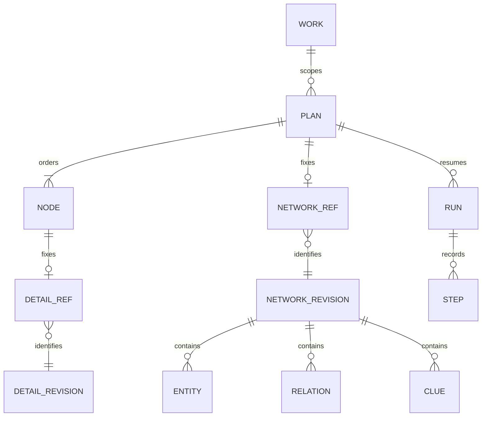
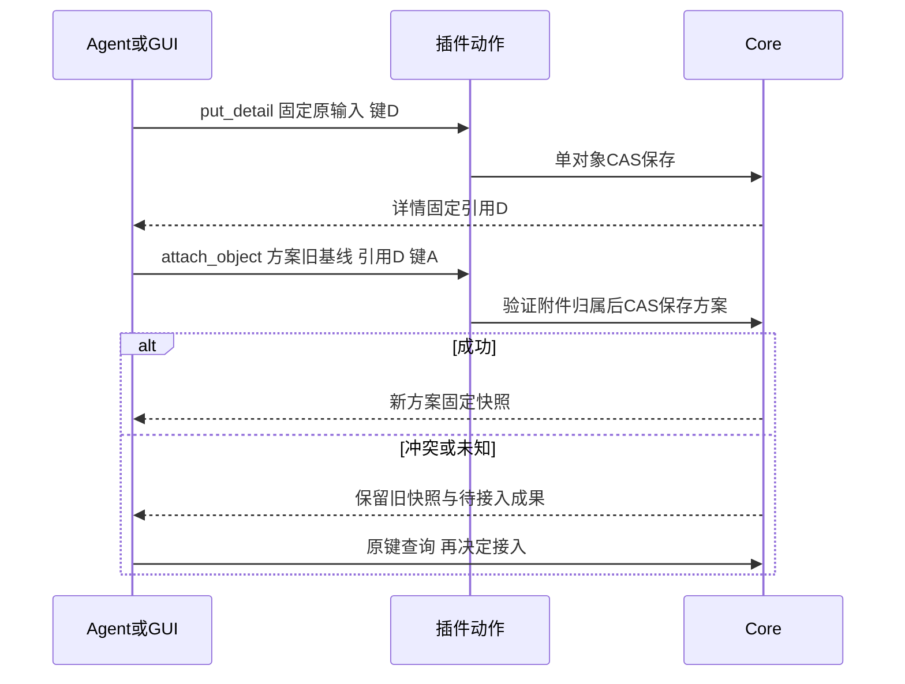

> 本文属于[小说规划文档](README.md)，拥有专业数据、不变量、存储与演进。机器合同归 contracts/plugin-manifest.json，文档样例由构建生成。

# 领域模型与数据合同

## 1. 数据Owner与聚合边界

完整首版包含整书结构、长篇剧情、实体关系和工作接续。只使用一个含全部长文的大JSON会碰到宿主传输与恢复预算；把每个章节都独立管理父子关系又会破坏移动的原子性。因此采用**单一结构聚合＋固定引用的详情／故事网络＋独立工作记录**。

| 类型 | 拥有的事实 | 事务范围 |
| --- | --- | --- |
| `novel_plan` | 方案、作者主张、整书／卷／章节点及顺序、预算、归档、固定附件引用 | 整棵结构一次保存，移动和重排不跨对象 |
| `novel_plan_detail` | 一个节点的概要、规划字段、详细剧情、节拍、实体关联与正式文档来源 | 每个节点详情独立修订 |
| `novel_plan_story_network` | 当前方案的规划实体、关系和伏笔网络 | 网络内部关联一次保存 |
| `novel_plan_run` | 交接目标、工作步骤、报告状态、原操作与成果引用 | 单条工作记录一次保存，不是执行引擎 |

正式卷章、正文、设定、大纲、作者决定归宿主；WorkRef、授权、来源、修订、CAS、操作及审计归Core。插件不建独立数据库、不直写权威目录。宿主当前采用文件权威与可重建JSON标题投影；本篇的实体关系不是SQL建表要求。

本篇是插件专业本体的唯一语义Owner。宿主创作本体及核心准入引用河图主28，公共身份引用主05，物理字段引用主29／contracts，应用动作引用主30，开放SDK引用插件27；不在本仓库重定义。规划节点、规划人物与伏笔表达作者工作中的设想，经正式来源关联宿主事实，不能因保存规划而自动成为正式章节或正典。

新增专业概念先给出实际用例及已有类型不能表达的原因，再更新本篇、contracts、04动作、05用例、07验收及CAPABILITIES；只改视图不重写领域。若需求涉及正文、正式目录或正典共享一致性，先反推宿主Owner与公开接口，避免在专业content里长期保存第二份可写事实。执行进度与证据仅归08。

## 2. 逻辑关系与固定快照

固定对象引用统一为`{object_id, revision, sha256}`。一个固定plan修订包含所有节点的detail_ref及story_ref，读取该修订即可重建确定的组合成果；不得悄悄替换为附件最新头。工作记录的动态进展单独展示，不纳入创作内容快照。相同标题不合并，ID不随重命名改变。

## 3. 方案与节点字段

`novel_plan`的content包含：format_version=1、root_id、author_constraints（Markdown）、nodes、story_ref（固定引用或null）、run_ids。对象外层title是方案名称，book节点title是作品规划标题，两者用途不同。

| 节点字段 | 合同 |
| --- | --- |
| `id`、`level`、`title`、`subtitle` | 稳定ID；book／volume／chapter；标题与副标题 |
| `planning_status` | unplanned／planning／planned／needs_revision；规划状态，不是批准或定稿 |
| `children` | 有序直接子节点ID，chapter为空 |
| `archived` | 独立归档标记；祖先归档时有效归档 |
| `target_chapters`、`target_words` | 非负整数，0为未设定；父级目标不强制等于子级目标之和 |
| `detail_ref` | 对应节点详情的固定引用，尚未准备时为null |

唯一book=root，无父；每个其他节点恰一父。book仅包含volume，volume仅包含chapter；无环、悬空、重复ID／孩子、多父及不可达节点。结构变换只改列明范围，不改变既有ID或level。整体更新也不能移除已有节点，移除通过归档表达；归档保留整分支。恢复父级不清掉后代独立归档标记；root不可归档。

## 4. 节点详情与详细剧情

`novel_plan_detail`的content固定format_version、plan_id、node_id，并包含以下全部字段。详情不可借同名挂到其他节点；来源仅使用当前作品。

| 字段 | 含义 |
| --- | --- |
| `summary` | 结构概要，与详细剧情分开 |
| `goal`、`theme`、`opening`、`conflict` | 目标、主题、开局、主要冲突 |
| `turns` | 有序转折文本 |
| `start_state`、`end_state`、`hook` | 起点、终点与悬念 |
| `detailed_plot` | Markdown长篇剧情，不使用短备注代替 |
| `beats` | 有序节拍：稳定id、title、summary、entity_ids、clue_ids |
| `entity_links` | 实体id、出场作用role及notes，表达当前节点内的计划用途 |
| `formal_documents` | document_id／revision_id／sha256；固定正式正文关联，须有对应外层source_refs |
| `notes`、`questions` | 自由说明与待确认问题，不伪装批准记录 |

卷内实体默认可选择“直接关联”或“包含子章”，并返回来源节点；不把全书所有人物算成本卷出场。正式文档引用不授权读取正文；实际字数与编辑入口经宿主桥接核权后获得。

## 5. 故事网络、规划卡与伏笔

`novel_plan_story_network`包含format_version、plan_id、entities、relations、clues。

| 集合 | 字段与规则 |
| --- | --- |
| entities | id、type（character／faction／location／item／rule）、name、summary、notes、archived、canonical_ref |
| canonical_ref | null表示规划候选；已关联时以source_index指向外层固定来源，并记录entity_ref；必须核验该来源确含该实体 |
| relations | id、from_id、to_id、label、notes、node_ids、archived；端点必须存在，重复语义提示但不按名称自动合并 |
| clues | id、title、description、status（open／developing／resolved／abandoned）、placements、notes、archived |
| placements | node_id、stage（plant／hint／payoff）、notes，定位埋设、提示和回收 |

候选卡可自由整理，不自动成为宿主正式设定。已关联卡的summary／notes表达规划用途，正式属性只读固定来源；修改正式设定另走宿主固定方案。物品优先关联宿主实际资源类型，不能伪造不存在的物品正典类型或借文本说明冒充Core验证。

引用可归档节点时仍保留原关联，检查报告说明其有效状态。归档卡、关系和线索保留身份及历史；恢复时重新检查端点。关系图与关系表读同一网络，不在画布另存一套关系事实。

## 6. 工作记录与进度

`novel_plan_run`包含format_version、plan_ref、target_node_ids、goal、state、steps、continuation。步骤含id、title、status、message、operation_key（可null）、result_ref（可null）及evidence。

run状态为prepared／handed_off／running／stop_requested／stopped／succeeded／failed／unknown；步骤为pending／running／succeeded／failed／unknown／skipped。evidence区分agent_report、core_receipt、external_receipt，并保留可核验locator。Agent报告不等于Core证明，不用于确认费用、批准或正文采纳。

停止请求只改变为stop_requested；只有外部执行方确认才可记录stopped，Core已成功写入的内容不因此回滚。succeeded必须核对必要步骤、固定成果与回执，不能因完成进度条就宣布创作完成。continuation保存可接续目标及引用，不保存模型密钥或任意执行脚本。

| 当前run状态 | 允许目标状态与条件 |
| --- | --- |
| prepared | handed_off或failed；新建只能prepared |
| handed_off | running、stop_requested、failed、unknown |
| running | succeeded、failed、unknown、stop_requested |
| stop_requested | stopped须外部确认；也可running、succeeded、failed、unknown，以真实结果为准 |
| unknown | 经确切回读变为running／stopped／succeeded／failed，或记录stop_requested |
| stopped／succeeded／failed | 终态不倒退；新目标建立新run，历史保持 |

同状态补充可核验步骤允许，已成功步骤及其结果不得改写；修正错误报告通过新证据说明。plan_ref及已有步骤ID保持，put_run更新同样执行状态机，不能通过整体替换绕过规则。

## 7. 跨对象保存与恢复

每次专业写动作只向Core提交一个权威save。创建／修改附件和接入方案分成两次明确调用，各自固定输入与原键，不能在一次调用里伪装跨对象原子提交。附件成功而接入失败时，附件标记为待接入成果；正常阅读继续旧固定引用。重复接入同一引用不制造重复节点；并发由方案CAS保护。

新附件的plan_id／node_id不能被后续更新改成别的对象。查到待接入对象不自动采用；由Agent或作者在原目标内明确接续。首版不自动清理孤立附件、不永久删除，避免把未知写误删。完整方案导出覆盖所选固定快照及归档分支；历史与待接入对象单独读取、另选导出，不混入当前快照冒充已接入成果。

## 8. 来源、校验与预算

外层身份、kind、owner_plugin_id、完整WorkRef、schema_version、revision及包摘要由Core提供，不允许专业content覆盖。当前source_refs支持同作品work／document／blueprint／asset／cue；无outline／volume类型。正式目录通过 work.snapshot 读取，章节映射使用固定 document 来源；不自造 outline／volume 已验证来源。

Schema负责类型、枚举与闭合字段；树、端点、附件归属、状态机及累计字节由共享TS校验。Core通用save不执行全部跨字段语义，所以专业读写都校验；坏数据保留原修订并返回诊断，不静默修复。正式数据关联必须经可信桥接核验，插件自报source_index不是证明。

| 插件预算 | 限制 |
| --- | --- |
| 结构／网络content | 各256 KiB；结构最多1000节点，网络实体／关系／线索各有Schema限制 |
| 单节点详情content | 512 KiB；长剧情按节点分开，不以千节点上限承诺千章同时最大内容 |
| 单工作记录content | 128 KiB，步骤有界，历史通过独立run保留 |
| 固定写输入 | 640 KiB，含控制字段与来源；Core真实1 MiB封装上限同时核验 |
| 视图恢复记录 | 896 KiB，低于宿主buffer 1 MiB；pending保存唯一确切输入，不重复三份完整详情 |
| 读取与导出 | 摘要分页默认20最大100；完整成果按固定清单分段，不产生超限单回执 |

单次 put_plan 接入新增或变更的详情引用最多100个，超出分批沿固定基线执行。查询与检查每批最多读取100个节点详情，工作记录默认每页5条并受回执字节预算约束。恢复稿以固定引用保存编辑基线，与 pending 相同的详情内容只保存一份。

文本长度与节点数不等于UTF-8字节。跨对象完整导出返回固定清单和分段内容，每段可校验、不截断、不把附件最新头混入旧快照。实际限制以安装版发现和实测为准。

## 9. 格式演进与退出

四类对象的Schema分别版本化，不因框架升级重写作品。新建expected_revision=0及空摘要，更新固定对象、revision和sha256。迁移由宿主固定方案执行，不在读取时静默升级。

停用或卸载后宿主仍能通用JSON／Markdown读取每个对象；专业整书排版导出依赖可用插件，通用导出不承诺同样排版。固定引用、结构和全部长文均为普通JSON／Markdown，不持久化Cordis对象。旧包、旧格式与缺包退出路径分别测试。

## 10. 机器评审样例

四类Schema与演示内容位于examples目录：[结构](examples/novel-plan.schema.json)、[详情](examples/novel-plan-detail.schema.json)、[故事网络](examples/novel-plan-story-network.schema.json)、[工作记录](examples/novel-plan-run.schema.json)，对应同名前缀的example.json。设计包见[plugin-manifest.design.json](examples/plugin-manifest.design.json)。示例是原创演示，ext_*_design_only及重复字符摘要都是设计占位，不是已创建对象或Core回执；示例内容的哈希不能替代Core完整对象哈希。

当前Schema为Draft-07，匹配宿主manifest验证路径。累计字节、唯一根、端点、状态机与引用归属仍由领域校验负责。构建生成的 dist 同时包含清单、backend.mjs、index.html 和静态资源；评审 example 中的占位引用不用于真实执行。

## 长篇专业深化

新增能力及兼容合同见[14-剧情决策与时间线设计](14-剧情决策与时间线设计.md)。字段以包清单Schema为准，专业动作与Skill由同包生成清单导航，实施及实际验证由08维护。
