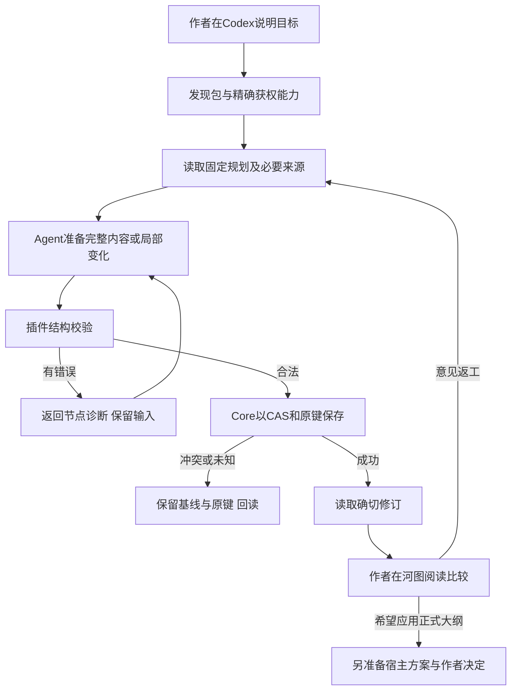
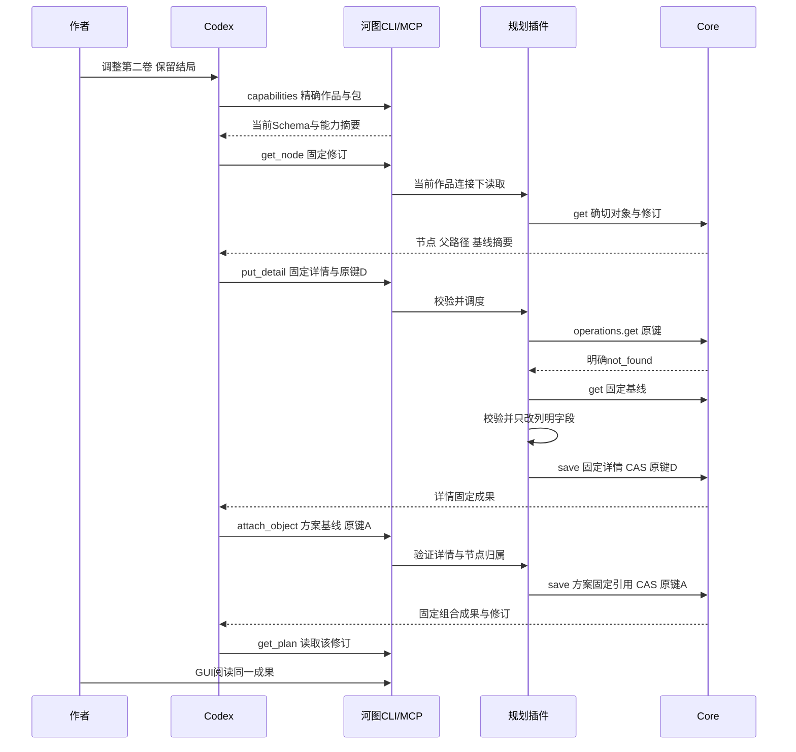
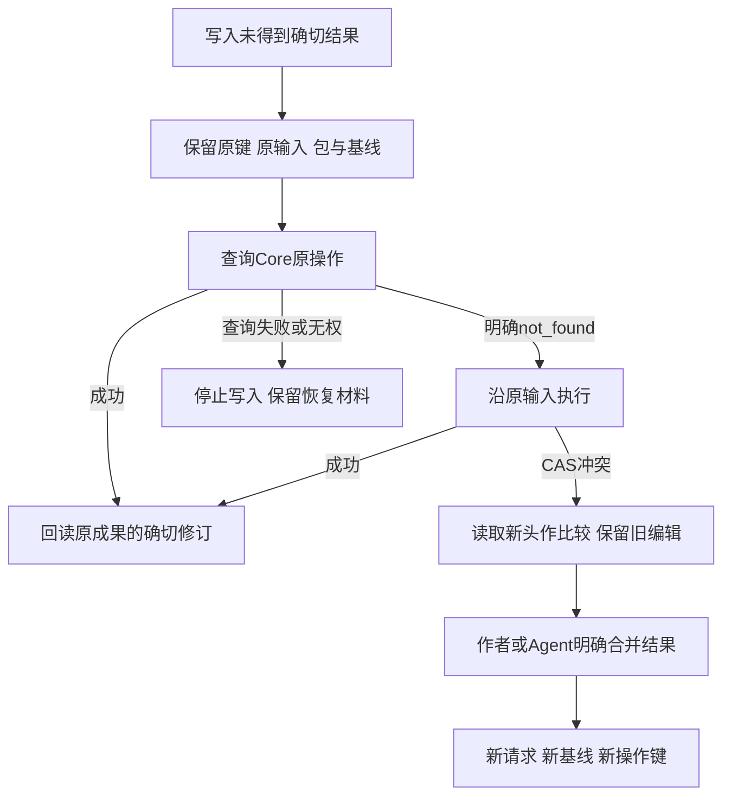

> 本文属于[小说规划文档](README.md)，拥有用户用例、主流程与异常路线。

# 用户故事与业务流程

## 1. 用例边界

作者决定创作取舍；Agent负责理解、生成及获权执行；插件负责确定性规划操作与阅读；Core负责身份、修订、事务与恢复。以下用例按输入、状态、并发和故障划分有限等价类，不声称穷尽任意插件与操作系统组合。

| 用例 | 用户故事与通过条件 |
| --- | --- |
| NPU-01 | 已建立Codex连接后安装插件，重新发现能力，无需新建Codex插件或窗口 |
| NPU-02 | 作者尚无规划，Agent创建总纲与卷章，回读完整方案供审阅 |
| NPU-03 | 作者只表达梗概，Agent先整理目标和待确认问题，不代填未经提供的作者决定 |
| NPU-04 | 作者只改第二卷，Agent按稳定ID修改，其他节点、正文及正式大纲保持 |
| NPU-05 | 作者增加一章，新ID插入确切位置，同名章不合并 |
| NPU-06 | 调整章节到另一卷，树与顺序一次提交，无半份结构 |
| NPU-07 | 暂弃某卷，归档保留全分支；恢复不清掉后代独立归档状态 |
| NPU-08 | 列出多份备选方案并分页，不按标题判相同，不默认只读第一页 |
| NPU-09 | 核对目标、冲突、首尾状态及预算；诊断不伪装创意质量认证 |
| NPU-10 | 对比两份固定历史修订，不因当前头变化改比较端点 |
| NPU-11 | 根据明确意见返工指定节点，固定原修订和范围，不扩大为全书重写 |
| NPU-12 | 作者可手动编辑，中文输入与恢复稿可用；保存同样校验并受CAS保护 |
| NPU-13 | Agent与作者并发修改，旧基线被拒，保留作者未保存输入 |
| NPU-14 | 保存成功但回执丢失，原键查到同一成果，不新建重复方案 |
| NPU-15 | 查询失败或not_found，分别停住或沿原输入执行，不将网络失败当未执行 |
| NPU-16 | 同键异内容、旧能力摘要及未知动作明确拒绝或保守核对，不覆盖原回执 |
| NPU-17 | 指向错误作品、其他插件数据或非活动包时拒绝，不能借同名或同根绕过 |
| NPU-18 | 作品连接撤销及插件停用时旧调用失效；重新启用须重查活动包及能力，不创建插件授权 |
| NPU-19 | 升级、坏包或Cordis激活失败不破坏已有规划，无关插件仍可用 |
| NPU-20 | 关闭桌面再由Codex读取、修改和导出，之后打开GUI同一修订 |
| NPU-21 | 卸载后仍可宿主通用JSON／Markdown读取，保留作品与历史 |
| NPU-22 | 导出指定版本，不默认导出最新头，不写任意文件或外发 |
| NPU-23 | 作者希望应用正式大纲，Agent另准备宿主方案；本版规划保存不推进正式指针 |
| NPU-24 | 上游正文或设定更新，旧方案来源保留；重新取依据需明确读取范围 |
| NPU-25 | 大内容、过多节点及恢复稿超预算明确拒绝，不截断为完整方案 |
| NPU-26 | 空列表、读错、撤权、冲突、unknown和坏数据分别显示，不都归为没有规划 |
| NPU-27 | 作者使用窄窗、浅暗主题或键盘，仍能阅读、比较与发起正确交接 |
| NPU-28 | 语义坏数据经通用保存进入后，专业读取诊断并保留修订，不静默修复 |
| NPU-29 | 方法文档可按需读取；未安装客户端Skill时不谎称已加载 |
| NPU-30 | 选择DSH插件时按宿主兼容等级处理；本插件不因采用Cordis宣称兼容 |

## 2. 从意图到审阅

## 3. 局部修改时序

图中最终GUI步骤表达作者查看结果，不是前面机器步骤的执行依赖。真实接入仍须检查invoke外层与内层状态。

## 4. 未知结果与冲突

新操作键只用于已经明确解决冲突后的一次新意图，不用于重试未知操作。停用后不为恢复偷偷启用旧包；先用宿主通用入口读取原结果并决定下一步。

## 5. 作者决定与意见

规划内的“待确认问题”由作者与Agent交流，不等于宿主批准记录。首版不新增伪审核状态字段；作者希望保留的内容放入author_constraints，但此字段不是权限锁。

返工交接固定WorkRef、插件和包、对象revision／sha256、节点ID及作者原话。复制提示词只表示已复制；宿主无消息能力时不显示Agent正在处理。插件context不包含机器grant等私密连接，交接由可信宿主准备；专用桥接未完成时使用现有宿主成果交接入口。

## 6. 完整首版扩展用例

| 用例 | 用户故事与通过条件 |
| --- | --- |
| NPU-31 | 完整填写卷副标题、概要、开局与详细剧情，保存后逐字段读取，不把长剧情缩成备注 |
| NPU-32 | 按副标题、目标或主题搜索当前固定方案，筛选状态和层级后定位节点 |
| NPU-33 | 卷状态、目标章节、已规划章节、正文实际字数分别显示 |
| NPU-34 | 同名人物、势力与地点分别关联到卷和子章，区分直接关联与包含后代 |
| NPU-35 | 规划物品、规则卡并关联真实宿主来源，未建正式设定时保留候选 |
| NPU-36 | 伏笔跨卷埋设、提示与回收，可定位所有相关章 |
| NPU-37 | 关系图和关系表查看同一组实体与关系，Agent可直接维护 |
| NPU-38 | 只返工某章详细剧情与节拍，其余节点保持 |
| NPU-39 | 详情保存后在接入前中断，再用原键接续 |
| NPU-40 | 两个客户端同时接入不同详情，方案CAS保护引用 |
| NPU-41 | 旧方案的附件头又有新修订，仍能阅读和导出旧组合成果 |
| NPU-42 | 完整导出分段中断后继续，清单覆盖结构、详情、关系及来源 |
| NPU-43 | 全书分卷有多个真实步骤，作者可从工作记录回到成果 |
| NPU-44 | 作者请求停止当前外部工作，收到或未收到停止确认分别处理 |
| NPU-45 | 当前卷与全书分卷分别交给所选Agent |
| NPU-46 | 根据规划准备正式卷章与大纲方案，逐项核对后执行 |
| NPU-47 | 从章规划打开实际正文，再返回原规划位置 |
| NPU-48 | 正文改动后统计可刷新，旧统计仍标明固定版本与单位 |
| NPU-49 | 宿主切语言或显式浅暗主题，插件同时更新 |
| NPU-50 | 修改已关联人物的正式属性，必须经宿主独立方案 |
| NPU-51 | 归档卷章、实体或线索后，回收区可查看影响并恢复 |
| NPU-52 | 重开工作面恢复草稿、pending、待接入成果和上次目标 |
| NPU-53 | 检查空目标、预算差、状态衔接与伏笔缺口 |
| NPU-54 | 通用保存产生类型合法但归属错误的附件或网络端点 |
| NPU-55 | 安装、停用或升级时仍有打开视图及正在执行的动作 |
| NPU-56 | 作者完成构思、分卷、章纲、详细剧情、关系伏笔、返工与正文接续 |

## 长篇专业深化

新增能力及兼容合同见[14-剧情决策与时间线设计](14-剧情决策与时间线设计.md)。字段以包清单Schema为准，专业动作与Skill由同包生成清单导航，实施及实际验证由08维护。
