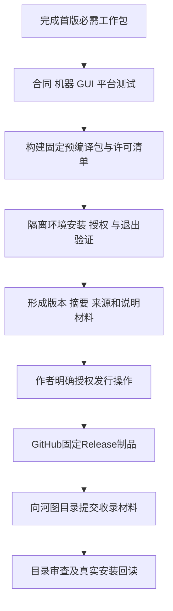

> 本文属于[小说规划文档](README.md)，拥有开发、包制作、上架和维护流程。当前可执行状态见08。

# 开发发布与上架

## 1. 开发者接入

先读CAPABILITIES、03／04的数据与动作合同，以及河图插件20～24、26。普通业务只依赖河图SDK；领域模块不导入Cordis、React或Rust内部。宿主内部选用Cordis不要求本包创建第二个容器，也不要求安装DSH。

工程采用 TypeScript／React／esbuild，使用 Node.js 25。package.json 声明运行范围，package-lock.json 固定完整依赖；宿主以独立受限 Node 执行预构建后端。

工程布局：

```text
contracts/        四类内容Schema、动作输入与生成的清单
src/domain/      无副作用的结构、详情、网络、工作记录规则
src/application/ 固定读取、单对象保存、引用接入及恢复
src/backend.ts   河图apply/invoke适配
src/view/        React阅读、编辑、关系及工作面
methods/         中文任务方法与模板
tests/           领域、真实宿主、MCP、GUI及平台验证
dist/            预构建plugin.json、backend.mjs、index.html与静态资源
```

## 2. 本地开发与验证

```bash
npm ci
npm run check
npm run build
node --experimental-strip-types --test tests/domain.test.ts tests/application.test.ts tests/write-flow.test.ts
```

真实集成测试使用已构建宿主，默认从本仓库定位 `../../limecloud/hetu`；其他布局设置 `HETU_SOURCE`。宿主先构建 Core CLI、MCP、插件 CLI、app-server、plugin_fixture 示例及桌面产物；具体构建入口以宿主 package.json 和 Cargo 工作区为准。

```bash
npm test
npm run test:ui
```

测试在独立临时目录创建小说与授权，不使用作者日常创作数据。机器测试启动真实 stdio MCP，并调用稳定 CLI；UI 测试启动真实 Electron 和 Core。运行证据见 output/machine-acceptance.json 与 test-results 下的 acceptance.json。Windows 须在 Windows runner 单独执行，不能以 Mac 结果替代。


contracts/plugin-manifest.json 是合同唯一源，构建生成 dist/plugin.json 和 docs/examples Schema，不能分别手改动作贡献和后端Schema。后端按普通JS模块打包，视图使用隔离Chromium，无Node直连与外部CDN。React及运行依赖包含于制品，不依赖作者本机node_modules。

宿主已构建开发工具时，可在本插件根目录运行以下只读包校验；设置HETU_ROOT为实际宿主源码目录。先运行本仓库 build 生成 dist，再进行包校验。

```bash
read -r 'HETU_ROOT?河图源码目录：'
node "$HETU_ROOT/apps/desktop/dist/plugin-dev.mjs" validate "$PWD/dist"
```

如宿主开发工具尚未构建，按宿主插件22的实际命令构建，不在此复制其依赖版本及构建细节。目录脚手架用于新项目，不能对已有本仓库执行create并覆盖资料。

开发循环为领域测试→静态包校验→隔离小说安装接入→CLI真实调用→MCP发现与调用→GUI同修订Review。开发HMR不等于生产热升级；包摘要变化需重新核验授权。正常业务测试不依赖桌面点击。

## 3. 制品与版本规则

一个发行包包含固定plugin.json、预构建后端与视图、所需静态资源、Schema／方法、许可及第三方声明。作者安装不运行包管理器、不执行install脚本、不编译Rust。先测宿主包大小与入口限制，再上传制品；不能只验证JSON结构。

GitHub承担源码、Issue、审查、Tag和Release制品；河图目录承担发现与收录。GitHub仓库不是作品存储，也不代表宿主自动信任其最新分支。版本、Tag及发行字节一一对应，同版不得悄悄换包。

分开记录下载压缩包SHA-256与宿主规范化包摘要package_sha256：前者校验传输字节，后者绑定安装快照、授权和能力。两者不能相互替代。目录记录固定版本、固定URL、源码提交、许可、平台和验收材料。

## 4. 发布与目录收录流程



发行、推送与目录提交须在作者明确授权的版本和操作范围内执行。官网收录遵循宿主插件23／24；未核验目录格式前不自造上架API。静态收录不等于已自动安装、运行通过或已被作者授权。

## 5. 发布材料与维护

| 材料 | 必需内容 |
| --- | --- |
| 身份 | org.wordflowlab.novel-planner、版本、Host API、四类数据与动作、权限 |
| 制品 | 固定下载地址、压缩包摘要、包摘要、源提交、构建与许可证信息 |
| 体验 | 完整功能说明、真实演示资料与操作图、首版范围和平台验证 |
| 验收 | NPT结果、宿主依赖版本、异常恢复、卸载导出、未解决问题 |
| 支持 | GitHub Issue、维护人、更新说明、兼容与安全修复策略 |

更新先校验新包与迁移影响，再由明确选择安装、重新核权；不从远端自动拉取可执行代码。宿主未提供签名信任、远端自动安装或自动升级时，文档不能宣称已经具备。

停用、卸载、换包、撤销目录收录与删除作品是不同动作。包缺失时保留所有结构、详情、网络、run和历史，可通用导出。安全问题先明确受影响版本、包摘要及建议动作，不远程删除作者作品。方法文档与客户端Skills分别版本化，不因插件升级悄悄覆盖客户端配置。
