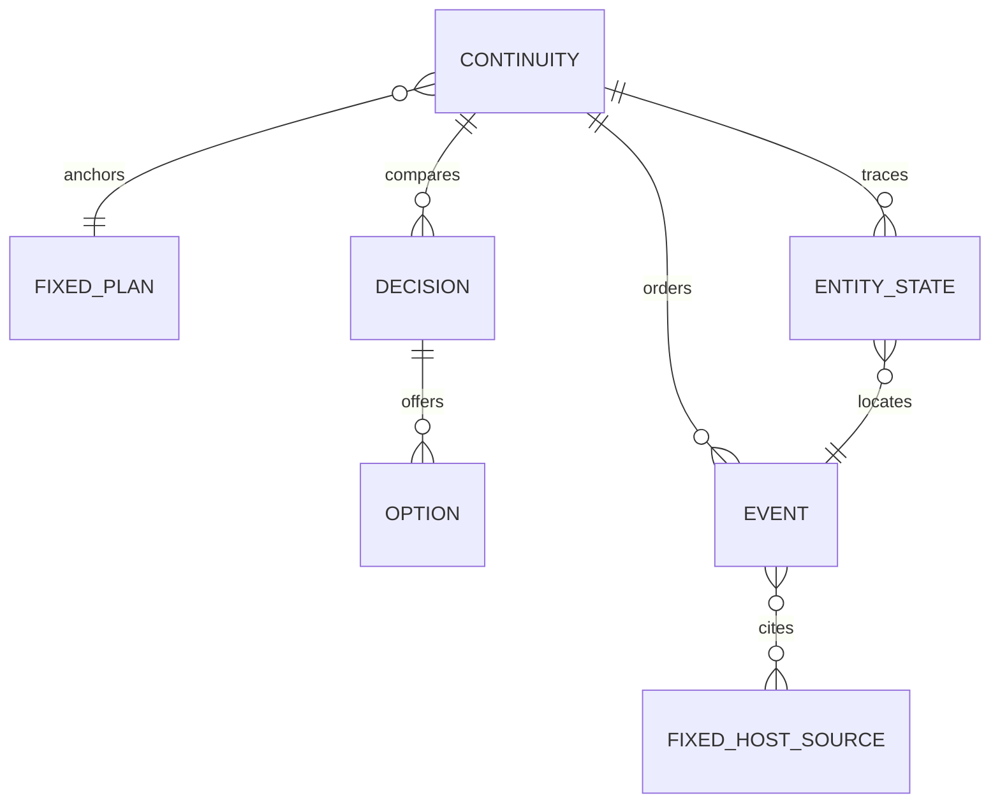
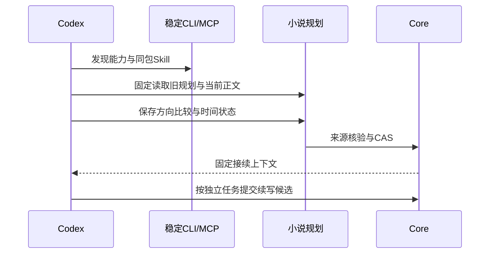
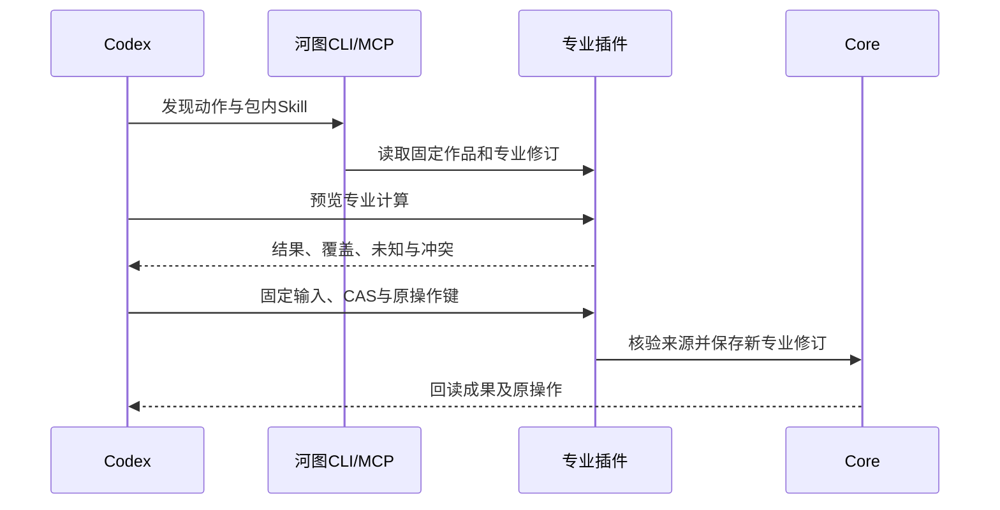

# 剧情决策与时间线设计

## 1. 目标与研究

参考已固定的dsh-novel-beat、long-novel-workbench与novel-workbench，不另建规划系统。整书→卷→章→候选→反馈→修订保持现有流程；新增“接下来有哪些真正不同的方向”和“谁在何时知道什么”的有据专业结构。

旧novel_plan保持原Schema；新增novel_plan_continuity聚合通过固定plan_ref关联一份规划修订，旧数据不强制迁移。插件版本升级不改变Core作品、本体与正式设定的归属。

## 2. 领域与数据

Continuity包含format_version、title、plan_ref、decisions、events、states。Decision包含id、title、question、options和selected_option_id；Option包含id、summary、costs、promises、consequences。选定选项仅表示规划方向，不代表已发生事实。Event包含id、title、story_time（字符串或null）、narrative_order、participants与evidence。State包含id、entity_ref、event_id、knowledge、condition与evidence。

宿主source_refs拥有来源；证据用source_index与UTF-8半开范围。事件和状态的实体为明确引用文本，不靠显示名称合并。未知时间保持null，人物知情与读者知情分别描述，推测不能补作正典。

## 3. 动作与架构

专业动作：list_continuities、get_continuity、save_continuity、put_decision、put_event、put_state、get_timeline、build_continuation_context。复用现有专业后端、ProjectStore与公开SDK，不增加第二个MCP服务器。固定plan_ref通过插件自身get_plan核验身份、修订和摘要。

## 4. 界面与用例

工作面增加连续性入口，展示方向比较、故事时间/叙事顺序和人物状态；默认阅读列表，可视图不要求作者拉线或编辑JSON。

| 用例 | 验收要求 |
| --- | --- |
| 旧规划不变 | 原聚合与21项既有专业动作回归 |
| 新书与导入书 | 先读已有规划/正文，再补过去与未来，不把新方向当回溯事实 |
| 方向比较 | 至少两个不同选项，代价和承诺清楚，选项引用有效 |
| 倒叙与未知时间 | story_time独立且允许null |
| 人物知情 | 状态必须锚定存在事件，证据可回读 |
| 计划更新 | 旧plan_ref不自动漂移，显式建新连续性或保存新基线 |
| 冲突与未知 | CAS失败保留输入；原操作查询恢复 |
| 专业接续 | build_continuation_context返回固定范围，续写仍由宿主任务承载 |
| 发行和热插拔 | 最终包全动作、Skill、安装卸载与数据保留 |

## 5. 实施要求

先写Schema与用例，再实现领域/应用/视图/Skill。功能清单由插件维护，宿主仅维护公开能力。任何公共来源或候选引用缺口先修宿主，不复制私有正文。进度和证据统一在08维护。

## 6. 时间语义与专业深化方案

本节为v0.2.0之后的拟议升级，尚未进入发布Schema或动作。静态核对发布Tag的`src/continuity/model.ts`和`src/continuity/application.ts`：当前`story_time`为字符串或null，`get_timeline`不能据此证明历法、时长或跨事件因果已经正确。已有方向比较、知情状态和续写接续的运行证据保持原范围。

### 6.1 时间不等于一个排序字段

| 维度 | 拟议表达与约束 |
| --- | --- |
| 叙事顺序 | 文稿／场景内的位置与明确顺序；倒叙可以后出现、先发生 |
| 故事定位 | 事件ID、相对前后、同时或区间；未知时间不填0或猜日期 |
| 日历时间 | 只有明确历法、纪元、单位与换算规则后才计算；虚构历法独立建模 |
| 精度与依据 | 精确、范围、相对、推测或未知；保留原文范围与解释 |
| 叙事层与分支 | 现实、梦境、传闻、假设和计划分别标记，不合并为同一实际时空 |
| 信息状态 | 明确人物、获知／误信／遗忘事件及证据；读者知情不等于人物知情 |

优先实现事件偏序及未知状态，不立即建设通用历法引擎。只有依据足以比较的事件才排序；不可比事件并列显示。约束环和矛盾返回具体事件及依据，不能强制排出一个假完整时间表。`story_time`继续作为原始显示标签保留，旧字符串不得自动解析为精确日期。

### 6.2 拟议数据与操作

| 结构或动作 | 责任与效果 |
| --- | --- |
| TemporalConstraint | 稳定ID、两个事件、before／after／simultaneous／区间、叙事层和证据；区间必须明确单位 |
| EventBasis | 既有稿复盘／未来规划／假设、固定来源及复核状态；选中走向不等于已经发生 |
| KnowledgeTransition | 人物引用、锚定事件、变化类型、命题及证据；不以自由文本相似度自动合并知识 |
| ImpactAnalysis | 固定规划与连续性引用、变动来源、受影响事件／人物／承诺、待复核范围；属于专业判断，不承诺完备召回 |
| `preview_temporal_constraints` | 拟议read动作；返回可比较顺序、约束冲突、未知项及依据，不落正文 |
| `preview_continuity_impact` | 拟议read动作；按新旧固定来源准备复核清单，不自动改旧事件或正式设定 |

这些名字仅用于方案评审，执行须以实际能力发现为准。新结构应由本插件拥有，审校消费明确约束，图鉴消费固定投影；不得相互导入内部实现。宿主只承担固定来源、公开对象引用与事务。存在真实跨插件来源缺口时先给出最小复现，再修改公共SDK。

### 6.3 从既有稿到下一章

跨章影响包括直接来源变化与事件／人物／伏笔依赖，保留“需要补读”的范围。局部重算只能证明选定范围的结果，不保证全书语义影响都被发现。作者采纳后仍沿新的固定正文复核，不能把未采纳候选自动转为已发生剧情。

### 6.4 兼容与升级验收

旧`novel_plan`、连续性v1及固定`plan_ref`保持可读和原义；新约束采用明确格式或可选扩展，实施时先定最低包版本及迁移测试。迁移产生新修订，不覆盖旧快照。更新依据、采用方向与正文采纳分别决定。

下列用例为待实施要求，不沿用已有测试数量宣称通过。

| ID | 输入与反例 | 必须证明 |
| --- | --- | --- |
| NPD-01 | 倒叙、插叙及“十年前／翌日／某年”标签 | 叙事与故事顺序分开，文字标签不直接计算年代 |
| NPD-02 | 日期未知、部分区间、不同历法 | 不可比项明确，缺单位不计算，未知不补0 |
| NPD-03 | A在B之前、B在C之前、C在A之前 | 返回具体矛盾环及依据，不静默重新排序 |
| NPD-04 | 读者先知、人物误信、梦境与传闻 | 人物知识、叙事层及可信程度分开 |
| NPD-05 | 已发生事件、选中未来走向与未采纳候选 | 不混成同一事实时间线 |
| NPD-06 | 只读三章却请求整书复盘 | 披露覆盖，先补读或交付部分复盘，不生成假完整过去 |
| NPD-07 | 改一章影响后文知情、伏笔和物品 | 影响清单有依赖依据；未复核保持待查 |
| NPD-08 | 同名人物、同ID的另一作品及撤权来源 | 引用隔离，缺来源不退回整库读取 |
| NPD-09 | 固定规划→章纲→候选v1→意见→v2→下一章 | 原键、固定来源与各次决定可追踪，不跳过已有稿复盘 |
| NPD-10 | 旧v1、CAS冲突、unknown及热升级 | 原修订可读；保留输入并按原键恢复，无自动改写 |

验证依次覆盖纯约束算法及反例、公开CLI/MCP、同一Codex会话Skill、正式包时间线与等价列表。跨作品系列目录属于独立专业需求，不因时间线深化而合并作品身份或授权。

## 本次实现合同

目标版本 `0.3.0`。范围为事件偏序与同时、时距约束、人物知情、来源覆盖与依赖影响。聚合保留原 `format_version=1`，新增可选 `depth.version=1`；旧对象读取、旧动作和历史修订原义保持。仅 `save_depth` 或新的逐项写动作显式建立深化结构；读取不自动迁移，保存通过宿主CAS产生新修订。旧客户端必须拒绝未知字段，不得裁掉深化结构后覆盖。

实际字段以包清单 Schema 为唯一来源。新动作均通过原有稳定 CLI/MCP 转发；纯 TypeScript 计算专业结果，React/SVG 展示，ProjectStore 负责固定来源与原键恢复，Core 拥有作品和决定。

| 动作 | 用途 | 效果 |
| --- | --- | --- |
| `put_event_basis` | 保存事件层次与依据 | managed_write |
| `put_temporal_constraint` | 保存事件偏序约束 | managed_write |
| `put_knowledge_transition` | 保存人物信息变化 | managed_write |
| `preview_temporal_constraints` | 检查偏序与时距约束 | read |
| `preview_knowledge` | 读取确切时点人物知情 | read |
| `preview_continuity_impact` | 分析来源变化与后续依赖 | read |
| `save_depth` | 保存明确专业深化结构 | managed_write |

测试分别覆盖纯算法反例、闭合Schema、非法来源、旧格式、CAS、丢失响应、真实CLI/MCP和实际工作面。实现与发行证据只在08维护；此处不以方案代替验收。

同作品跨插件依据使用可选 `depth.basis_refs`，每项固定Owner、对象、修订与摘要；保存和 `inspect_basis` 经公开Core读取核验。不把专业引用塞进正文来源索引，不导入其他插件内部模块；旧依据不随上游更新。没有另一作品连接时不能跨作品读取。
