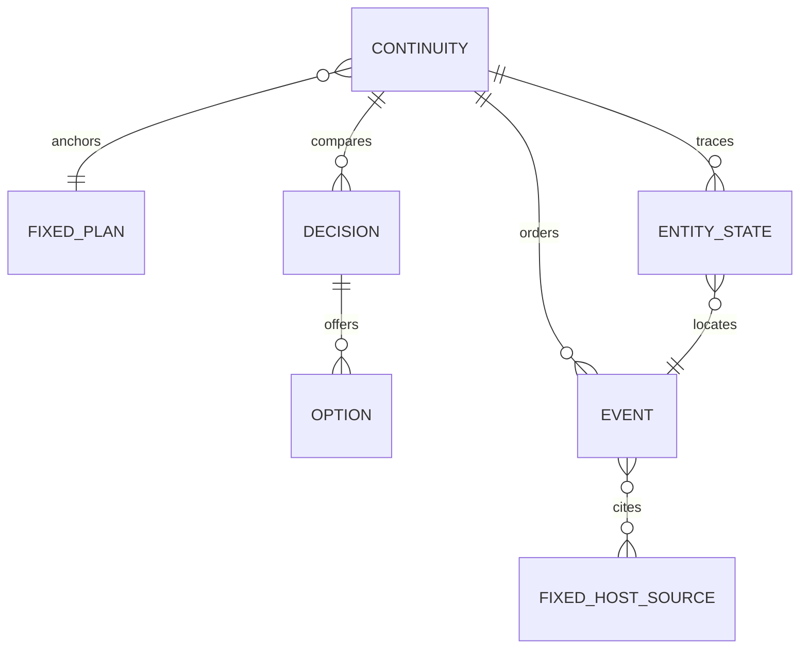
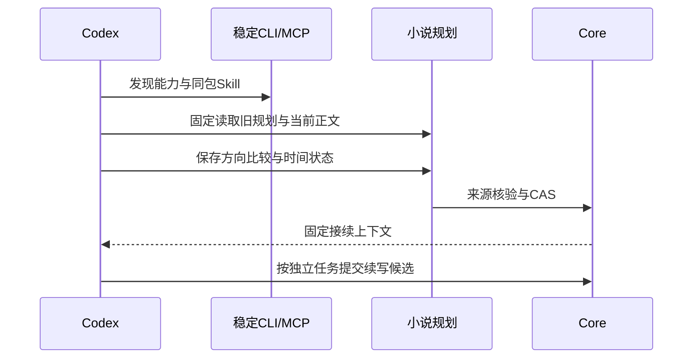

# 剧情决策与时间线设计

## 1. 目标与研究

参考已固定的dsh-novel-beat、long-novel-workbench与novel-workbench，不另建规划系统。整书→卷→章→候选→反馈→修订保持现有流程；新增“接下来有哪些真正不同的方向”和“谁在何时知道什么”的有据专业结构。

旧novel_plan保持原Schema；新增novel_plan_continuity聚合通过固定plan_ref关联一份规划修订，旧数据不强制迁移。插件版本升级不改变Core作品、本体与正式设定的归属。

## 2. 领域与数据

Continuity包含format_version、title、plan_ref、decisions、events、states。Decision包含id、title、question、options和selected_option_id；Option包含id、summary、costs、promises、consequences。选定选项仅表示规划方向，不代表已发生事实。Event包含id、title、story_time（字符串或null）、narrative_order、participants与evidence。State包含id、entity_ref、event_id、knowledge、condition与evidence。

宿主source_refs拥有来源；证据用source_index与UTF-8半开范围。事件和状态的实体为明确引用文本，不靠显示名称合并。未知时间保持null，人物知情与读者知情分别描述，推测不能补作正典。

## 3. 动作与架构

专业动作：list_continuities、get_continuity、save_continuity、put_decision、put_event、put_state、get_timeline、build_continuation_context。复用现有专业后端、ProjectStore与公开SDK，不增加第二个MCP服务器。固定plan_ref通过插件自身get_plan核验身份、修订和摘要。

## 4. 界面与用例

工作面增加连续性入口，展示方向比较、故事时间/叙事顺序和人物状态；默认阅读列表，可视图不要求作者拉线或编辑JSON。

| 用例 | 验收要求 |
| --- | --- |
| 旧规划不变 | 原聚合与27类既有能力回归 |
| 新书与导入书 | 先读已有规划/正文，再补过去与未来，不把新方向当回溯事实 |
| 方向比较 | 至少两个不同选项，代价和承诺清楚，选项引用有效 |
| 倒叙与未知时间 | story_time独立且允许null |
| 人物知情 | 状态必须锚定存在事件，证据可回读 |
| 计划更新 | 旧plan_ref不自动漂移，显式建新连续性或保存新基线 |
| 冲突与未知 | CAS失败保留输入；原操作查询恢复 |
| 专业接续 | build_continuation_context返回固定范围，续写仍由宿主任务承载 |
| 发行和热插拔 | 最终包全动作、Skill、安装卸载与数据保留 |

## 5. 实施要求

先写Schema与用例，再实现领域/应用/视图/Skill。功能清单由插件维护，宿主仅维护公开能力。任何公共来源或候选引用缺口先修宿主，不复制私有正文。进度和证据统一在08维护。
